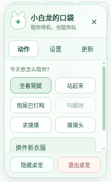

# 白龙娘 GPT · Windows 桌宠

白发、珍珠龙角、薄荷绿眼睛，搭配 GPT 标志头饰的小龙娘形象。

## 安装与使用

前往 [最新 Windows 安装版](https://github.com/rudong1/dragon-purge/releases/latest)，下载 `DragonGPT-版本号-x64-Setup.exe`。首个可安装版本是 [v0.1.1](https://github.com/rudong1/dragon-purge/releases/tag/v0.1.1)，支持 Windows 10/11 x64。

- 安装时创建桌面快捷方式；安装完成后即可启动桌宠。
- 拖动人物可以移动桌宠，位置、大小和姿势会保存。
- 直接右击人物会打开奶白与薄荷绿的“小白龙的口袋”菜单，动作、设置、更新分为三个页签；退出固定在底部。
- 人物左上角常驻 **更新** 按钮；也可 **右击人物 → 更新 → 立即检查更新**，查看当前版本、检查结果、下载进度并重启安装。
- 托盘图标仍提供系统菜单，可以切换姿势、大小、置顶、开机启动和检查更新。
- 点击头部会得到摸头反应；拖动超过小段距离才移动窗口，短点击不会把桌宠拖走。
- 菜单中选择 **退出桌宠** 即可关闭；也支持 Alt+F4。
- 安装版启动后检查更新，每六小时自动复查并下载。下载完成后选择 **重启并安装更新**；不会未经选择就重启。
- 已安装时，可从菜单再次创建桌面快捷方式。

快捷方式由 Windows 上的安装程序和应用创建；云端开发环境不会直接操作你的电脑桌面。当前 Windows 安装器尚未配置代码签名证书。

## v0.2.1 人物右键与更新入口

补齐“托盘里有更新，但直接右击人物找不到”的入口：人物右键菜单与托盘菜单各自可用。人物菜单采用小龙角装饰与薄荷绿配色，支持键盘切换页签、Esc 关闭，小尺寸桌宠也保留可见的退出按钮。



如果你安装的是旧版，需要先安装新版才能看到这个界面；也可以先从旧版托盘菜单更新。开发模式会明确显示未启用自动更新，安装版会显示实际检查与下载状态。

v0.2.1 的发行文件上传不完整，请使用 v0.2.2 或之后的完整发行版。新的发布流程先核对安装器、更新清单和 SHA-512，再上传到草稿；远端文件的数量与字节数全部匹配后才公开发布，避免构建成功但下载入口缺失。

## v0.2.0 连续动作

| 动作 | 节奏与触发方式 |
| --- | --- |
| 坐着晃腿 | 腿部约 10 秒一轮，尾巴约 12 秒缓慢摆动，脸部保持稳定 |
| 抱尾巴打盹 | 三分钟没有点击或拖动桌宠后，先用 7 秒慢慢入睡；也可以从动作菜单手动打盹 |
| 点击醒来 | 点击睡着的桌宠，保留 10 秒揉眼醒来的动作，再回到待机 |
| 求摸摸 | 空闲 75 秒后低头等待摸摸，持续 18 秒；也可以从动作菜单触发 |
| 摸头与开心摇尾巴 | 点击头部或“摸摸头”，先享受摸摸 7 秒，然后尾巴连续轻拍 45 秒 |
| 换装坐姿 | 奶白针织开衫和薄荷绿裙装，坐着抬起一只脚，羞涩询问“今天的我好看吗？”，持续 22 秒 |

姿势立绘用约 1.4 秒平滑过渡；反复收到更新状态不会把动作从头播放。网页和安装版共用同一套动作与时序代码。系统开启“减少动态效果”时保留姿势切换并停用局部摆动；图形上下文不可用时退回静态立绘，避免桌宠消失。

[抱尾巴睡姿](docs/assets/desktop-pet-sleeping.png) · [揉眼醒来](docs/assets/desktop-pet-waking.png) · [求摸摸](docs/assets/desktop-pet-asking.png) · [开心反应](docs/assets/desktop-pet-happy.png) · [坐姿换装](docs/assets/desktop-pet-showcase.png)


## 坐姿桌宠

默认使用坐在地上的姿势，双脚自然向前、脚底可见。图片含透明通道，适合无边框桌宠窗口。


[下载坐姿透明 PNG](docs/assets/desktop-pet-sitting.png) · [站姿透明 PNG](docs/assets/desktop-pet.png)

## 开发与发布

需要 Node.js 22.12+。在仓库目录执行：

```sh
npm ci
npm start
```

Windows 上构建安装程序：

```sh
npm test
npm run dist:win
```

安装器输出在 `release/`。自动更新读取此仓库 GitHub Releases 的公开发布版，不需要用户填写 GitHub Token。

发布新版本时先更新 `package.json` 和 `package-lock.json` 的版本号，再推送匹配的版本标签，例如 `v0.2.3`。`.github/workflows/release.yml` 会在 Windows 上安装锁定依赖、运行测试，再使用 `--publish never` 完成 NSIS 构建。`scripts/release-files.cjs` 会验证实际安装器和 `latest.yml`；清单缺失时为本次新安装器生成标准更新清单，清单已存在却校验不符时直接失败。GitHub CLI 随后上传到草稿、核对远端文件大小，最后公开发行并设为最新版本。已公开的同版本不会被覆盖，重发需递增版本号。

应用由 Electron 主进程管理窗口、托盘、快捷方式和更新；渲染进程只通过限定的 IPC 调用桌宠操作，不具备 Node.js 权限。设置保存在应用用户数据目录的 `preferences.json`。目前是桌宠框架与立绘待机效果，尚未接入 GPT 对话、眨眼、口型或完整 Live2D 绑定。

## 全身桌宠 · 透明 PNG

完整站姿，从龙角到双脚都保留；白色小龙娘、薄荷绿 GPT 头饰、赤脚造型。


[查看 / 下载全身透明 PNG](docs/assets/desktop-pet.png)

网页预览提供站姿、坐姿、睡醒、摸头和换装动作按钮，也可以暂停局部摆动。

## 早期半身动效

六秒循环待机：轻轻呼吸、发梢与龙尾缓慢摆动，头饰和聊天气泡微微发光。

<details>
<summary>展开查看早期半身动效</summary>


[查看高清原画](docs/assets/preview.png) · [查看 MP4 动画](docs/assets/idle.mp4) · [查看 GIF 动图](docs/assets/idle.gif)

</details>

## 网页预览

预览网页位于 [docs/index.html](docs/index.html)。支持手机和电脑，可手动切换动作、点击互动并下载当前姿势的透明 PNG。

如需启用 GitHub Pages，在仓库 **Settings → Pages** 中选择 **Deploy from a branch**，分支选择 **main**，目录选择 **/docs**。网站是否上线以 Pages 设置中的部署状态为准。

当前动效是基于立绘的轻量待机效果；尚未加入眨眼、口型或完整 Live2D 绑定。

## 已完成的验证

32 项逻辑与发行校验测试在 Node.js 22 和 24 上均通过；真实 Electron 图形环境中验证了局部腿部 / 尾巴运动、7 秒入睡与 10 秒唤醒、点击摸头、45 秒开心时长、换装、拖动、减少动态效果和退出；固定时刻的重复渲染像素一致。另已实际验证直接右击人物打开主题菜单、Esc 关闭、小尺寸退出按钮与常驻更新入口；进度和重启按钮使用受控状态验证。云端图形验证使用软件图形驱动，窗口拖动测试在隔离进程中注入了系统光标位置。Windows 安装器由 GitHub Actions 的 Windows 构建机生成；目前尚未人工验证真实 Windows 桌面的安装、快捷方式和跨版本升级流程。
